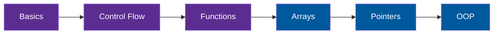

---

## 🧑‍💻 Block 1: About Me

> [!NOTE]
> Hello! I'm **Hafiz Irshad**, a **BS Computer Science** student (Roll No: **L1S26BSCS0012**). I'm learning **C++ programming** and I write and test all my programs in **Visual Studio**. This repository is where I share my code, practice work, and progress.

## 🪪 Block 2: Student ID Card

| Field | Details |
|:---|:---|
| **Name** | Hafiz Irshad |
| **Roll Number** | L1S26BSCS0012 |
| **Program** | BS Computer Science |
| **Main Language** | C++ |
| **IDE** | Visual Studio |
| **GitHub** | [@hafiz-irshad47](https://github.com/hafiz-irshad47) |

## 🛠️ Block 3: Skill Set


| Skill | What I do with it | Status |
|:---|:---|:---:|
| **C++** | Variables, loops, functions, arrays | 📘 Learning |
| **Visual Studio** | Write, build, run, and debug programs | ✅ Using daily |
| **Problem Solving** | Break tasks into small logical steps | 🧩 Practicing |
| **Git and GitHub** | Save and share my code | 🔄 Practicing |

## 🗺️ Block 4: My C++ Learning Roadmap



> [!TIP]
> Purple topics are what I'm studying now. Blue topics are coming next.

## 💻 Block 5: Sample Program

```cpp
#include <iostream>
using namespace std;

int main() {
    cout << "Name: Hafiz Irshad" << endl;
    cout << "Roll Number: L1S26BSCS0012" << endl;
    cout << "Program: BS Computer Science" << endl;
    return 0;
}
```

<details>
<summary><b>How to run it in Visual Studio</b></summary>

1. Open Visual Studio and choose **Create a new project**.
2. Select **Console App** (C++) and click **Next**.
3. Paste the code into the main `.cpp` file.
4. Press **Ctrl + F5** to build and run.

</details>

## 🔎 Block 6: Keywords

> [!IMPORTANT]
> **Hafiz Irshad** | **L1S26BSCS0012** | BS Computer Science student | C++ programming | Visual Studio | beginner C++ projects | computer science student portfolio | learning to code | programming practice | object-oriented programming

`hafiz irshad` `l1s26bscs0012` `bscs` `computer science` `cpp` `c++` `visual studio` `student portfolio` `programming` `coding` `beginner` `oop`

---


**Hafiz Irshad** | L1S26BSCS0012 | BS Computer Science
